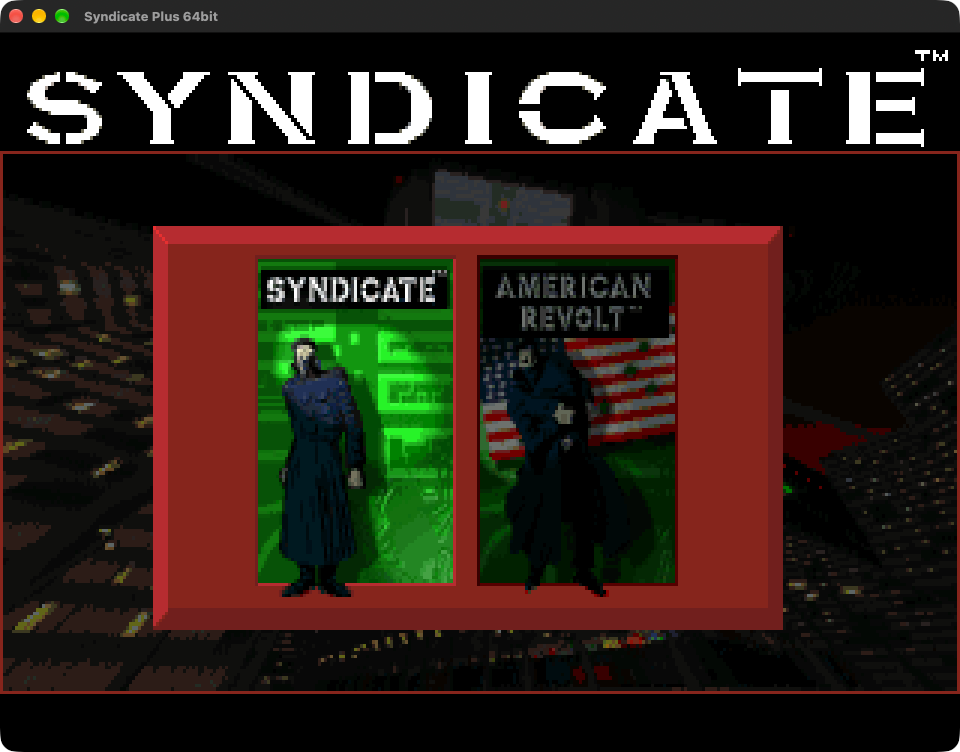
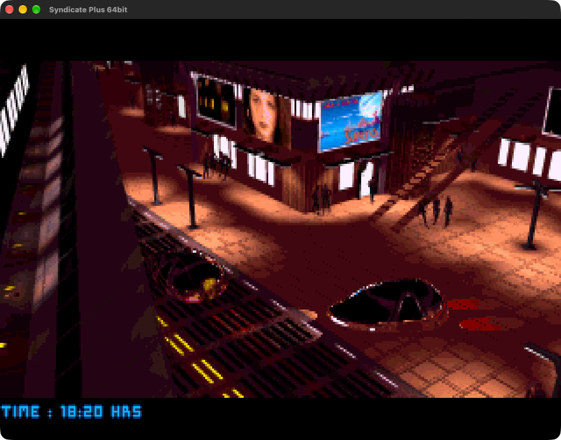
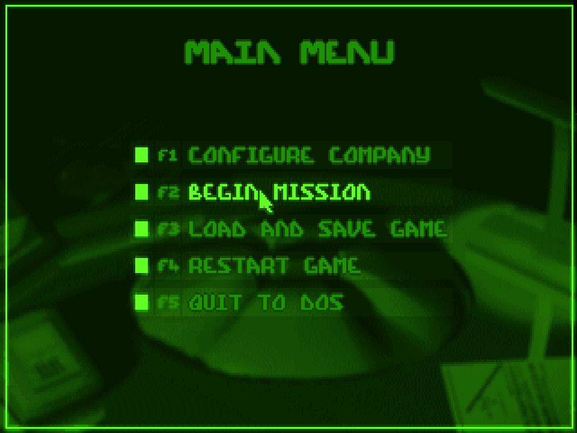

# synd: Syndicate Plus 64bit

A static recompilation of the 1993 DOS game *Syndicate Plus* (Bullfrog's *Syndicate* with the *American Revolt*
data disk) into a native 64-bit program for **Windows (x64)**, **macOS** (one universal app for Apple silicon
and Intel Macs, macOS 11 or later) and **Linux** (SDL2).

The original 32-bit DOS/4GW programs are translated to C function by function (`tools/recomp.py`); a small
portable runtime stands in for DOS, DPMI, the BIOS, the VGA card, the timer, the keyboard, the mouse, the Sound
Blaster and the AdLib (OPL2) chip.  The result is the original game, unchanged, running at its original pace,
with its own sound and music, in a window or full screen.

| The game selection | The intro | Syndicate's main menu |
|---|---|---|
|  |  |  |

**You need your own copy of the original game.**  Nothing of the original game is in this repository: not its
programs or data, and not the C code generated from its programs.  The program reads the original files at run
time and checks that they are the ones it was built from.

## Download

[Releases](https://github.com/Buyukcaglar/synd/releases) has the Windows program (`Syndicate64.exe`, 64-bit
Windows 10 or later) and the macOS app (signed and notarized).  On first start it asks for the folder of your
Syndicate Plus installation (the one with `SYND.EXE`), then remembers it.

## The game files

The program needs the Syndicate Plus files as installed by the original (DOS) game, for example from the CD
or a digital release: the folder with `SYND.EXE`, `DOS4GW.EXE`, `DATA`, `SYNDICAT` (Syndicate), `DATADISK`
(American Revolt) and `SYND`.  English, French, Italian, Spanish and German installations all work.  The files
are never changed: everything the game writes goes to a `Save` folder next to the program.

## Building

Both platforms build the same way: first the C code is generated from your copy of the game, then CMake builds
the program.

1. Put the game folder (the one with `SYND.EXE`) at `_references/dos` in this repository.
2. Generate the code (Python 3 and [Capstone](https://www.capstone-engine.org/)):

       pip install capstone
       python3 tools/gen_all.py         # writes gen/ (about 38 MB of C)

3. Build:

   - **Windows**: Visual Studio 2022 or later with the C++ workload, then `build.cmd`.  The result is
     `build/Syndicate64.exe` (and `synd_headless.exe`, the test program).
   - **macOS**: the Xcode command line tools, CMake and optionally Ninja (`brew install cmake ninja`), then
     `./build.sh`.  The result is `build/Syndicate64.app` (universal) and `build/synd_headless`.
   - **Linux**: a C compiler (GCC or Clang), CMake, SDL2's development files and optionally Ninja
     (Debian/Ubuntu: `sudo apt install build-essential cmake ninja-build libsdl2-dev`; Fedora:
     `sudo dnf install gcc cmake ninja-build SDL2-devel`; Arch: `sudo pacman -S base-devel cmake ninja sdl2`),
     then `./build.sh`.  The result is `build/Syndicate64` and `build/synd_headless`.

When `_references/dos` is present the build puts the game files *inside* the program (CMake option
`SYN_EMBED_GAME`), so your own copy is one self-contained file to keep or carry around.  Such a build contains
the game: keep it to yourself.  Configured with `-DSYN_EMBED_GAME=OFF` (on macOS: `./build.sh
-DSYN_EMBED_GAME=OFF`) CMake builds a program that asks for the game folder instead.

On macOS the app is signed ad hoc by default, which is enough on the Mac that built it.  To give it to others,
sign it with a Developer ID and notarize it:

    ./build.sh -DSYN_EMBED_GAME=OFF -DSYN_CODESIGN_IDENTITY="Developer ID Application: <name> (<team id>)"
    tools/notarize_mac.sh build/Syndicate64.app <notarytool keychain profile>

## Playing

The original launcher comes first: pick *Syndicate* or *American Revolt* with the arrow keys and Enter (the
launcher has no mouse pointer, as on DOS).  Without game files built in, the program looks for the game next to
itself (on Linux also `--game-dir DIR`), in `_references/dos` of a source checkout and in the folder chosen last time; otherwise it asks.

Saved games go to `Save/Syndicate` and `Save/American Revolt` next to the program (on macOS: next to
`Syndicate64.app`, never inside it), the settings to `Syndicate64.ini` beside it.  Where that folder cannot be
written to, both go to `%LOCALAPPDATA%\Syndicate64` (Windows), `~/Library/Application Support/Syndicate64`
(macOS) or `~/.local/share/Syndicate64` (Linux).

| | Windows | macOS | Linux |
|---|---|---|---|
| Full screen (on the display the window is on) | Alt+Enter, or the window menu | Ctrl+Cmd+F, the green button, or View > Full Screen | Alt+Enter |
| CRT scanlines (off at first, remembered) | Alt+S, or the window menu | Cmd+Shift+S, or View > CRT Scanlines | Alt+S |
| About | the window menu (Alt+Space) | the app menu | F12 |
| The game's Alt key | Alt | Option | Alt |
| Right button | right click | right click or Ctrl+click | right click |

In full screen the pointer stays on the picture while the game has the focus (free in menus, dialogs and when
you switch to another program).  The game pauses while a dialog is open or the window is minimized.  The
window, the menus and the About box follow the system's dark or light mode.  On a Mac laptop the function keys
need Fn unless they are set to act as standard function keys.

## Tests

    python3 tests/run_tests.py           # about 20 s to 1.5 minutes; --quick leaves out the full-length intro
    SYND_ARCH=x86_64 python3 tests/run_tests.py    # macOS: the Intel half of the universal build (Rosetta)

The tests play the games headless on an emulated clock (runs repeat exactly) and check pictures, files and
sound: the launcher in several installations, the main menus of both games in every language, a mission, shooting,
saving and loading, the intro music and length, the built-in files, and that two runs end on the same frame.
They need the game files in `_references/dos`.

## Layout

| Path | What it holds |
|------|---------------|
| `tools/` | `le.py` (LE/LX loader), `discover.py` (code discovery), `recomp.py` (x86 to C translator), `gen_all.py` (writes `gen/`), `pack_game.py` (the built-in game files), icon and notarization helpers |
| `src/rt/` | the portable runtime: CPU state, DOS/DPMI/BIOS, VGA, timer, keyboard, mouse, Sound Blaster and OPL2 |
| `src/game/` | which recompiled DOS programs make up the game and how it starts |
| `src/video/` | the CRT scanline filter |
| `src/platform/` | the front ends: `win32/`, `macos/`, `linux/` (SDL2), `posix/` (shared POSIX services), `headless/` (tests) |
| `res/` | icons, the Windows resources, the macOS `Info.plist` |
| `tests/` | the automated tests |

`src/rt/host.h` is the whole boundary between the portable core and a platform.

## Licence

The code of this port is under the MIT licence (`LICENSE`).  *Syndicate*, *Syndicate: American Revolt* and
*Syndicate Plus*, their programs, sound drivers, data and box art belong to their owners; they are not part of
this software.  This project is not affiliated with or endorsed by them.

64bit version by Onur BUYUKCAGLAR, with Anthropic Claude AI assistance.
